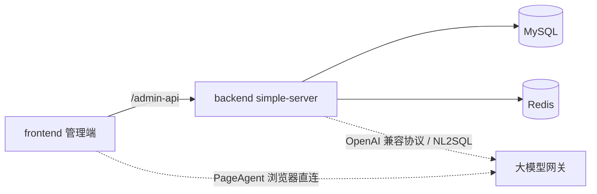

# Simple Boot 基础脚手架

基于 ruoyi-vue-pro（MIT）精简的业务应用脚手架：后端 + 管理端，可登录、可跑通、内置 AI 与 NL2SQL 能力，用于快速搭建业务应用系统。

## 工程结构

```
25/
├── backend/                  # 后端（Spring Boot 3.5 / JDK 17）
│   ├── simple-dependencies/  #   依赖 BOM，统一版本管理
│   ├── simple-framework/     #   框架组件（安全、MyBatis、Redis、MQ、任务、监控等 starter）
│   ├── simple-server/        #   启动入口（端口 48080）
│   ├── simple-module-system/ #   系统管理：用户 / 角色 / 菜单 / 租户 / 字典 / 通知
│   ├── simple-module-infra/  #   基础设施：文件 / 配置 / 定时任务 / 代码生成 / 知识库
│   ├── simple-nl2sql/        #   NL2SQL：自然语言转只读 SQL（安全闸 + 表白名单）
│   ├── sql/mysql/            #   数据库脚本与一键初始化脚本
│   └── script/               #   校验、Docker、Jenkins、部署等脚本
├── frontend/                 # 管理端（Vue 3 + Vite + Element Plus，默认端口 80）
├── docs/                     # 文档：需求说明书 / 概设 / 详设 / 数据库设计 / 操作手册
├── slides/                   # 演示文稿（PPT）
├── test/                     # Playwright 测试工程与测试报告
├── settle/                   # 部署与总结
```

## 目录索引

只列本仓库这 8 个目录。各目录的细目以该目录自己的说明为准。

| 目录 | 说明 | 入口 |
|------|------|------|
| `backend/` | 后端。Spring Boot 3.5 / JDK 17，含系统管理、基础设施、NL2SQL、启动入口与 MySQL 脚本 | [backend/README.md](backend/README.md) |
| `docs/` | 文档层：需求分析实例、阶段提示词、项目文档、模板，以及技能落盘的规格与计划 | [docs/README.md](docs/README.md) |
| `frontend/` | 管理端。Vue 3 + Vite + Element Plus，默认端口 80 | [frontend/README.md](frontend/README.md) |
| `settle/` | 部署与总结。本机演示和单机部署说明 | [settle/部署文档.md](settle/部署文档.md) |
| `slides/` | 演示文稿。后续在此存放 PPT | — |
| `test/` | Playwright + POM 测试工程。覆盖登录、系统管理与 AI 助手，并存放方案、记录表和测试报告 | [test/readme.md](test/readme.md) |

## 架构总览



## 技术栈

| 端 | 主要技术 |
|----|----------|
| 后端 | Spring Boot 3.5、JDK 17、MyBatis-Plus、Redis、Quartz、MapStruct、Knife4j |
| 管理端 | Vue 3.5、Vite 8、TypeScript、Element Plus、Pinia、UnoCSS、vue-i18n |
| AI 能力 | OpenAI 兼容协议、LangChain4j（NL2SQL）、LangGraph（任务规划）、JSQLParser（SQL 安全闸） |
| 运行依赖 | MySQL 8、Redis 6+ |

## 快速开始

### 环境要求

- JDK 17+、Maven 3.6+
- MySQL 8、Redis 6+
- Node.js >= 20.19、pnpm >= 8.6

### 1. 初始化数据库

一键建库并导入结构、Quartz、菜单精简与种子数据（`sql/mysql/init.sql`）：

```powershell
cd backend\sql\mysql
.\init-all.ps1 -Database simple-project
```

### 2. 启动后端

1. 使用 `backend/simple-server/src/main/resources/application-dev.yaml`。默认库 `simple-project`，账号 `root` / `root`。本机不同时用环境变量 `MYSQL_HOST`、`MYSQL_PORT`、`MYSQL_DATABASE`、`MYSQL_USERNAME`、`MYSQL_PASSWORD` 覆盖。
2. 打包并启动：

```powershell
cd backend
mvn -pl simple-server -am clean package -DskipTests
java -jar simple-server\target\simple-server.jar --spring.profiles.active=dev
```

### 3. 启动管理端

```powershell
cd frontend
pnpm install
pnpm dev        # 或 .\dev.ps1（自动选择本机合规 Node 版本）
```

访问 http://localhost:80 （端口由 `frontend/.env` 的 `VITE_PORT` 控制）。

## 默认账号与端口

| 项 | 值 |
|----|-----|
| 登录租户 | Simple |
| 登录账号 | admin / admin123 |
| 后端端口 | 48080 |
| 管理端端口 | 80 |
| 文件上传 | 默认本地目录 `./data/file` |

## AI 能力

1. **PageAgent 页面助手**：管理端内嵌的网页操作助手（源码位于 `frontend/src/libs/page-agent`，来自 alibaba/page-agent v1.12.4，MIT）。支持自然语言操作后台页面（`open_menu`）、业务知识库问答（`search_knowledge`）、业务数据查询（`query_data` 调用后端 NL2SQL）、命令历史录制回放。由 `frontend/.env*` 中的 `VITE_PAGE_AGENT_*` 控制，默认指向测试网关，接入生产时替换为合规网关。
2. **业务知识库**：接口 `/admin-api/infra/knowledge/**`，新增文档自动切块并向量化，检索优先走 embedding 语义匹配，未配置模型时自动降级为关键词匹配。需配置 `simple.ai.openai` 与环境变量 `OPENAI_API_KEY` 才能启用向量化。
3. **NL2SQL 模块**（`backend/simple-nl2sql`）：自然语言 → SELECT → JSQLParser 安全闸（仅单条 SELECT、表白名单、强制 LIMIT、自动注入租户与软删条件）→ 执行查询 → 口语化回答。接口 `POST /admin-api/nl2sql/query`。
4. **后端 AI 最小封装**：`OpenAiCompatibleClient`（`chat` / `embed`），Key 一律走环境变量，未配置时降级返回空值，不阻塞业务。

## 常用脚本

| 路径 | 说明 |
|------|------|
| `backend/script/verify/verify-all.ps1` | 品牌扫描 + 结构检查 + 构建 + API 冒烟 |
| `backend/script/docker/` | docker-compose（MySQL + Redis + server）、环境变量模板 |
| `backend/script/jenkins/Jenkinsfile` | Jenkins 流水线模板 |
| `backend/script/idea/http-client.env.json` | IDEA HTTP Client 环境变量 |
| `backend/script/部署/` | 本地 MySQL 建库与查询说明 |
| `frontend/dev.ps1` | 前端启动脚本（自动选择合规 Node） |
| `frontend/demo-kb.cjs` | 知识库检索对照演示（`node demo-kb.cjs`，不依赖真实 embedding） |

## 文档索引

- 后端模块与启动说明：[backend/README.md](backend/README.md)
- NL2SQL 模块说明：[backend/simple-nl2sql/README.md](backend/simple-nl2sql/README.md)
- 校验脚本说明：[backend/script/verify/README.md](backend/script/verify/README.md)
- Docker 说明：[backend/script/docker/Docker-HOWTO.md](backend/script/docker/Docker-HOWTO.md)
- 考核规则：[说明.md](说明.md)、[题目.md](题目.md)

## 注意事项

- 所有密钥（数据库密码、模型 Key）禁止写入仓库，统一使用环境变量或本地未入库配置文件。
- 代码与模块命名遵循 `cn.simple.boot` / `simple-*` 前缀，不引入非常规技术框架。
- 提交前执行 `backend/script/verify/verify-all.ps1` 确认脚手架健康度。
